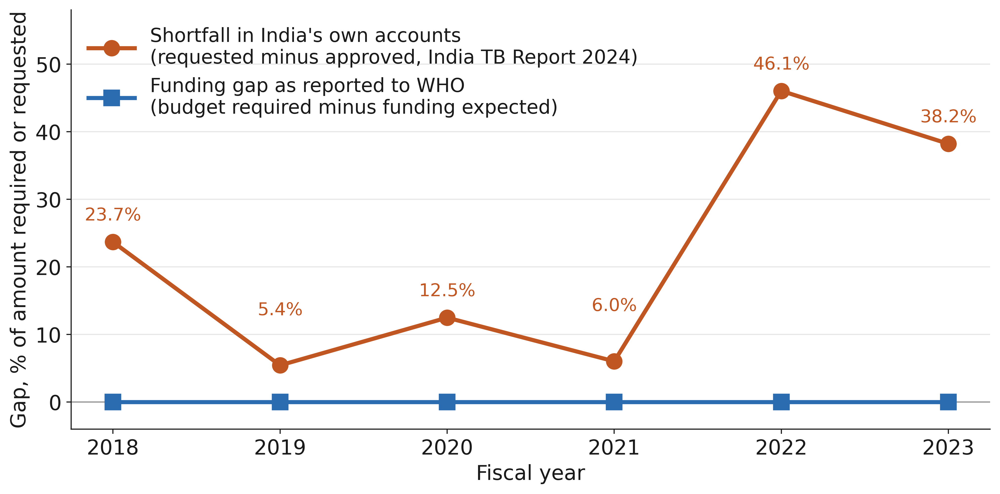
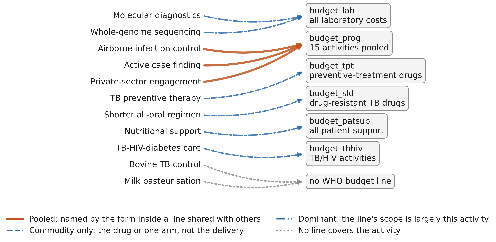

# Figures

**Manuscript.** What a tuberculosis budget cannot see: fiscal invisibility and the limits of the WHO funding-gap indicator in India, 2017–2025

Figures are supplied separately as 600 dpi TIFF files for production; PNG previews are embedded below.

## Figure 1

{width=6.3in}

**Figure 1. Two accounts of the same years.** India's funding gap as reported to WHO, against the shortfall recorded in India's own programme accounts, 2018–2023. The WHO-reported gap is zero in every year because expected funding is reported equal to budget required; over the same years the national accounts record approvals falling short of requests by 5.4% to 46.1%. Values are percentages of the amount required (WHO) or requested (national accounts). National years are the first year of India's April–March fiscal year (2018 denotes 2018–19); the WHO series is plotted by reporting year. Sources: WHO TB budget dataset [7] and India TB Report 2024, report table 16.1 [2].

## Figure 2

{width=6.3in}

**Figure 2. Where each intervention falls in WHO's budget classification.** Eleven TB interventions, in the order of Table 2, joined to the WHO budget line that covers them as judged against the data collection form [9]. Line style marks the condition of that coverage: pooled, where the form names the activity inside a line shared with many others; commodity only, where the line covers the drug or one arm but not the delivery; dominant, where the line is largely the activity though still shared; and no line. Three interventions converge on budget_prog, one figure pooling fifteen activities. No arrow ends at a line specific to its own intervention.
